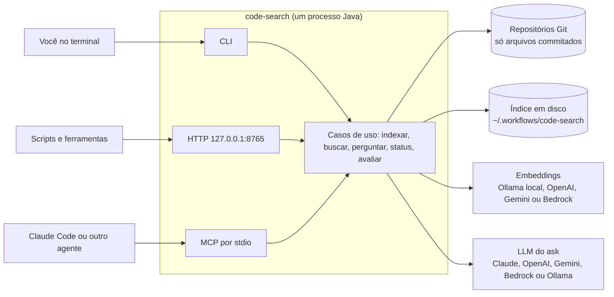
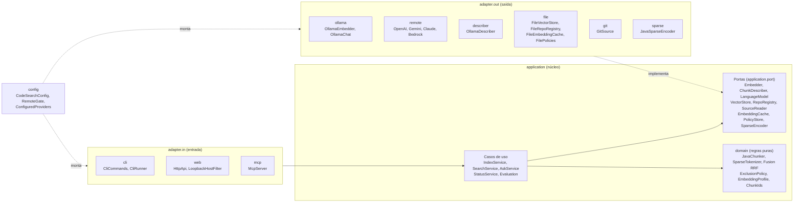
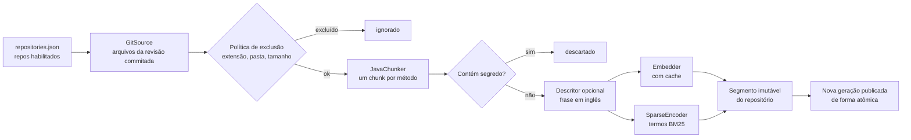
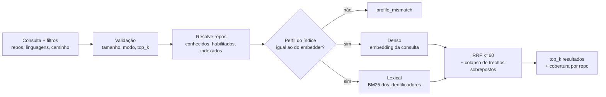
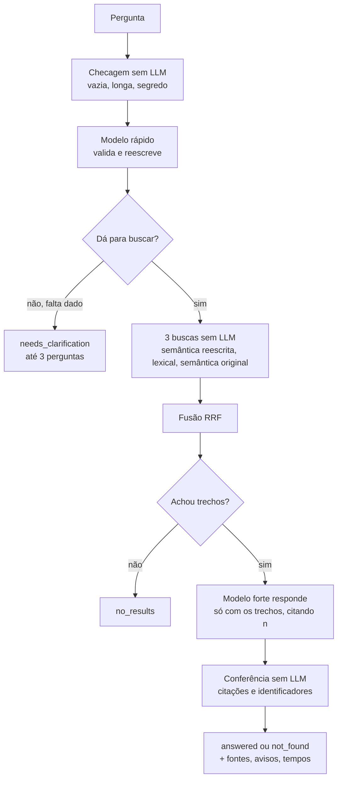
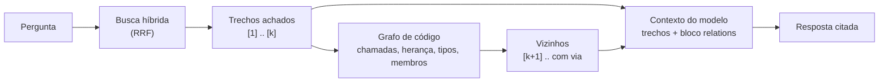

# code-search (Java, Spring Boot)

Serviço de busca de código em vários repositórios Java ao mesmo tempo. Combina busca semântica (embeddings), busca lexical
(BM25 sobre identificadores) e fusão RRF, e responde perguntas em linguagem natural citando os trechos achados. Roda como
linha de comando, servidor HTTP local (só `127.0.0.1`) e servidor MCP para agentes como o Claude Code.

É a versão Java de `luan-vega/code-search-embeddings` (Python), com a mesma arquitetura hexagonal, os mesmos formatos de
avaliação e paridade conferida em teste.

- [Visão geral](#visão-geral)
- [Como rodar](#como-rodar)
- [Arquitetura](#arquitetura)
- [Fluxos](#fluxos)
- [Provedores de IA](#provedores-de-ia)
- [Pergunta em linguagem natural (ask)](#pergunta-em-linguagem-natural-ask)
- [Referência: comandos, HTTP e MCP](#referência-comandos-http-e-mcp)
- [Configuração](#configuração)
- [Armazenamento](#armazenamento)
- [Segurança](#segurança)
- [Desenvolvimento](#desenvolvimento)
- [Estado e próximos passos](#estado-e-próximos-passos)

## Visão geral



| O que você quer | Comando |
|---|---|
| Achar métodos por conceito, nome ou trecho de código | `search "juros compostos da parcela"` |
| Uma resposta explicada, com citações e plano de execução | `ask "como é calculado o juros composto?"` |
| Dar a um agente acesso de leitura ao código indexado | `mcp` (ferramentas `search_code`, `ask_code`, `code_search_status`) |
| Medir a qualidade da busca com um dataset rotulado | `eval --dataset ... --thresholds ...` |

## Como rodar

### 1. Pré-requisitos

| Item | Para quê | Observação |
|---|---|---|
| Java 21 (JDK) | rodar e compilar | o CI usa Temurin 21 |
| Maven 3.9+ | compilar e testar | |
| Git | ler os repositórios | só o que está commitado é indexado |
| Ollama + um modelo de embedding | embeddings locais (padrão) | ex.: `ollama pull qwen3-embedding:0.6b`; a app nunca baixa modelo sozinha |
| `ANTHROPIC_API_KEY` | `ask` com a Claude (padrão) | opcional; também dá para usar OpenAI, Gemini ou Ollama |

Sem Ollama, dá para indexar com `--embedder openai` ou `--embedder gemini` (veja [Provedores de IA](#provedores-de-ia)).

### 2. Compilar

```bash
mvn -B verify                    # compila e roda os testes
mvn -B -DskipTests package       # só gera o jar: target/code-search-0.1.0-SNAPSHOT.jar
```

Crie um atalho para não repetir o `java -jar` (os exemplos daqui em diante usam `code-search`):

```bash
# Linux, macOS ou Git Bash no Windows
alias code-search='java -jar /caminho/para/spec-embeddings-java/target/code-search-0.1.0-SNAPSHOT.jar'
```

```powershell
# PowerShell
function code-search { java -jar C:\caminho\para\spec-embeddings-java\target\code-search-0.1.0-SNAPSHOT.jar @args }
```

### 3. Configurar o embedder

```bash
export CODE_SEARCH_OLLAMA_MODEL=qwen3-embedding:0.6b   # o modelo precisa estar instalado no Ollama
code-search ollama-probe                                # mostra modelo, dimensão e profile_id
code-search providers                                   # o que está configurado e o que falta em cada provedor
```

### 4. Indexar

```bash
code-search policy init                                  # grava a política de exclusão padrão (uma vez)
code-search repo add pagamentos /caminho/svc-pagamentos  # raiz padrão: src/main/java
code-search repo add cadastro /caminho/svc-cadastro --root src/main/java --root modulo/src/main/java
code-search index                                        # indexa os repositórios habilitados
code-search status                                       # geração ativa, chunks e revisão de cada repo
```

A indexação é incremental: repositório sem commit novo é pulado, e embeddings já calculados vêm do cache. Rode `index` de
novo depois de cada commit que deve aparecer na busca.

### 5. Buscar e perguntar

```bash
code-search search "calcular juros compostos da parcela"
code-search search calcularJurosComposto --mode lexical --repo pagamentos --top-k 5
code-search search "double m(double v, int n) { return v * Math.pow(1.02, n); }" --mode semantic --json

export ANTHROPIC_API_KEY=...                             # no ambiente, nunca em arquivo do repositório
code-search ask "como é calculado o juros composto da parcela?" --allow-remote
```

### 6. Servidor HTTP

```bash
code-search serve                       # 127.0.0.1:8765 (só aceita loopback)
curl -s http://127.0.0.1:8765/ready
curl -s -X POST http://127.0.0.1:8765/v1/search -H 'Content-Type: application/json' \
     -d '{"query": "estornar pagamento", "top_k": 5}'
curl -s -X POST http://127.0.0.1:8765/v1/ask -H 'Content-Type: application/json' \
     -d '{"question": "onde o estorno devolve o dinheiro ao comprador?"}'
curl -sN -X POST http://127.0.0.1:8765/v1/ask/stream -H 'Content-Type: application/json' \
     -d '{"question": "onde o estorno devolve o dinheiro ao comprador?"}'   # resposta aparecendo aos poucos (SSE)
```

Para o `/v1/ask` usar um provedor externo, suba o servidor com `CODE_SEARCH_ALLOW_REMOTE=1` e a chave no ambiente.

### 7. MCP (Claude Code e outros agentes)

O servidor MCP fala JSON-RPC por stdio e é somente leitura. Exemplo de `.mcp.json`:

```json
{
  "mcpServers": {
    "code-search": {
      "command": "java",
      "args": ["-jar", "/caminho/para/code-search-0.1.0-SNAPSHOT.jar", "mcp"],
      "env": { "CODE_SEARCH_OLLAMA_MODEL": "qwen3-embedding:0.6b" }
    }
  }
}
```

Não coloque chaves de API nesse arquivo. Para a ferramenta `ask_code` usar a Claude, deixe `ANTHROPIC_API_KEY` e
`CODE_SEARCH_ALLOW_REMOTE=1` no ambiente de onde o agente é aberto.

## Arquitetura

Arquitetura hexagonal: o núcleo (`domain` e `application`) não conhece Spring, HTTP, Ollama nem disco; tudo isso fica em
adapters ligados por portas. As regras de dependência são verificadas em `ArchitectureTest` (ArchUnit) a cada build.



| Pacote | Papel | Pode depender de |
|---|---|---|
| `br.codesearch.domain` | tipos e regras puras | nada (nem Spring) |
| `br.codesearch.application` | casos de uso e portas (`application.port`) | domain |
| `br.codesearch.adapter.in` | CLI, HTTP, MCP | application, domain, frameworks (não `adapter.out`) |
| `br.codesearch.adapter.out` | Ollama, provedores externos, arquivos, Git | application, domain, frameworks (não `adapter.in`) |
| `br.codesearch.config` | composição: escolhe adapters por propriedade | tudo |

### Mapa dos pacotes

```
br.codesearch
├── CodeSearchApplication        ponto de entrada: serve (HTTP) ou um comando de CLI
├── domain                       JavaChunker, CodeGraph, SparseTokenizer, Fusion, ExclusionPolicy, EmbeddingProfile, ...
├── application                  IndexService, SearchService, AskService, GraphContext, StatusService, Evaluation, ...
│   └── port                     Embedder, ChunkDescriber, LanguageModel, VectorStore, RepoRegistry, SourceReader, ...
├── adapter
│   ├── in
│   │   ├── cli                  CliCommands, CliRunner, EvalFiles
│   │   ├── web                  HttpApi, HttpErrors, LoopbackHostFilter
│   │   ├── mcp                  McpServer
│   │   └── Payloads             formato JSON compartilhado por HTTP, MCP e CLI
│   └── out
│       ├── ollama               OllamaClient, OllamaEmbedder, OllamaChat
│       ├── remote               OpenAiEmbedder, GeminiEmbedder, RemoteDescribers, RemoteChats, RemoteHttp
│       ├── bedrock              BedrockConnection, BedrockEmbedder, BedrockChat, BedrockDescriber
│       ├── describer            OllamaDescriber, DescriberPrompt
│       ├── file                 FileVectorStore, FileRepoRegistry, FileEmbeddingCache, FilePolicies, ...
│       ├── git                  GitSource
│       └── sparse               JavaSparseEncoder
└── config                       CodeSearchConfig, CodeSearchProperties, RemoteGate, ConfiguredProviders, DataPaths
```

## Fluxos

### Indexação



Repositório sem commit novo é pulado. A troca de geração é atômica: quem está buscando continua lendo a anterior até o fim.

### Busca



Modos: `hybrid` (padrão, denso + lexical), `semantic` (só denso) e `lexical` (só BM25). A resposta diz quais repositórios
foram pesquisados e por que algum ficou de fora (`unknown_repo`, `disabled`, `no_index`).

### Pergunta (ask)



## Provedores de IA

Busca e indexação usam o Ollama por padrão. A pergunta (`ask`) usa a Claude por padrão. Todo provedor externo é escolhido
por comando ou variável de ambiente, sem mexer no código:

| Papel | Opções | Escolha |
|---|---|---|
| embedder (consultas e documentos) | `ollama` (local), `openai`, `gemini`, `bedrock` | `--embedder X` ou `CODE_SEARCH_EMBEDDER` |
| describer (frase em inglês por método, na indexação) | `ollama` (local), `openai`, `claude`, `gemini`, `bedrock` | `--describer X` ou `CODE_SEARCH_DESCRIBER` |
| llm (pergunta: `ask`, `POST /v1/ask`, MCP `ask_code`) | `claude` (padrão), `openai`, `gemini`, `bedrock`, `ollama` (local) | `--llm X` ou `CODE_SEARCH_LLM` |

- **Externo = o texto sai da máquina** (código dos métodos, consultas, perguntas). Só funciona com `--allow-remote` no comando
  (ou `CODE_SEARCH_ALLOW_REMOTE=1`), e um aviso em stderr diz o que vai e para onde.
- **Chaves só por variável de ambiente**: `OPENAI_API_KEY`, `ANTHROPIC_API_KEY`, `GEMINI_API_KEY`. No Bedrock não há chave do
  projeto: vale a cadeia padrão de credenciais da AWS (veja abaixo). Nunca em arquivo de configuração, log ou mensagem de erro. HTTPS é obrigatório (HTTP só em loopback, para servidores compatíveis locais).
- A Anthropic não tem API de embeddings: a Claude descreve métodos e responde perguntas, mas não gera embeddings.
- Trocar de embedder ou de describer muda o perfil do índice: use um `CODE_SEARCH_HOME` separado para cada combinação ou
  reindexe.
- **AWS Bedrock** (`bedrock` nos três papéis): usa o AWS SDK for Java v2 e a cadeia padrão de credenciais da AWS
  (`AWS_ACCESS_KEY_ID`/`AWS_SECRET_ACCESS_KEY`/`AWS_SESSION_TOKEN`, `AWS_PROFILE`/SSO ou role do ambiente), nada é guardado
  pelo projeto. Região em `CODE_SEARCH_BEDROCK_REGION` ou `AWS_REGION`; `CODE_SEARCH_BEDROCK_ENDPOINT` troca o endereço
  (VPC endpoint). O `llm` e o `describer` usam a Converse API (Claude, Nova, Llama, Mistral...) e **exigem o id do modelo** em
  `CODE_SEARCH_LLM_MODEL` / `CODE_SEARCH_DESCRIBER_MODEL` (por exemplo um perfil de inferência `us.anthropic.claude-...`
  liberado na sua conta). O embedder aceita `amazon.titan-embed-text-v2:0` e `cohere.embed-*` (padrão
  `cohere.embed-multilingual-v3`, em `CODE_SEARCH_BEDROCK_MODEL`; dimensão opcional em `CODE_SEARCH_BEDROCK_DIMENSIONS`).
  A conta precisa ter acesso ao modelo (`bedrock:InvokeModel`), e o Titan faz uma chamada por texto, então indexar é mais lento
  que com o Cohere (96 textos por chamada).
  ```
  export AWS_REGION=us-east-1   # mais as credenciais da AWS no ambiente
  code-search index meu-repo --embedder bedrock --allow-remote
  code-search ask "onde é calculado o frete?" --llm bedrock --allow-remote   # com CODE_SEARCH_LLM_MODEL definido
  ```
- `code-search providers [--json]` mostra o que está configurado e o que falta em cada provedor, sem chamar nenhum e sem
  mostrar chaves.

Exemplos:

```bash
# indexar com embedder local e descrição de métodos pela Claude
export ANTHROPIC_API_KEY=...
code-search index --describer claude --allow-remote

# tudo pela OpenAI
export OPENAI_API_KEY=...
code-search index --embedder openai --allow-remote
code-search ask "onde é calculado o frete?" --embedder openai --llm openai --allow-remote   # pede CODE_SEARCH_LLM_MODEL

# pergunta pelo Gemini
export GEMINI_API_KEY=...
code-search ask "onde é calculado o frete?" --llm gemini --allow-remote
```

Para acrescentar outro provedor, implemente a porta `Embedder`, `ChunkDescriber` ou `LanguageModel` em `adapter.out`,
acrescente um `case` em `CodeSearchConfig` e a entrada em `ConfiguredProviders`.

## Pergunta em linguagem natural (ask)

`search` devolve trechos; `ask` responde a pergunta em três passos (veja o [diagrama](#pergunta-ask)):

1. **Validar e reescrever** (modelo rápido, uma chamada): decide se dá para buscar ou se falta dado. Se falta (por exemplo
   "como mapear esta variável" sem dizer qual), devolve `needs_clarification` com até 3 perguntas e não busca nada. Se dá,
   extrai identificadores Java e uma frase de busca em inglês. Resposta fora do formato não bloqueia: vira busca com a
   pergunta original.
2. **Buscar** sem LLM: semântica com a frase reescrita, lexical com os identificadores e semântica com a pergunta original,
   fundidas por RRF.
3. **Responder** (modelo forte, uma chamada) só com os trechos achados, citando cada um como `[n]`; `not_found` quando eles
   não bastam. Quando a pergunta pede como fazer algo, a resposta traz um plano de execução numerado. A resposta é conferida
   sem LLM: citação para trecho inexistente, identificador entre crases que não aparece em nenhum trecho e resposta sem
   citação viram `warnings`.

```bash
code-search ask "como é calculado o juros composto da parcela?" --allow-remote [--repo ID]... [--top-k 8] [--json]
```

| Status | Significado | Saída da CLI |
|---|---|---|
| `answered` | resposta com citações | 0 |
| `not_found` | os trechos achados não respondem | 1 |
| `no_results` | a busca não achou nada | 1 |
| `needs_clarification` | falta dado; veja `questions` | 1 |

- Modelos padrão na Claude: `claude-haiku-5-5` valida (`CODE_SEARCH_LLM_FAST_MODEL`), `claude-opus-5-5` responde
  (`CODE_SEARCH_LLM_MODEL`). No Gemini, `gemini-2.5-flash` nos dois. OpenAI e Ollama pedem `CODE_SEARCH_LLM_MODEL`; o modelo
  rápido usa o mesmo se não for dado.
- O que sai da máquina: a pergunta (validação) e a pergunta com os trechos achados (resposta). Pergunta com cara de segredo
  (chave AWS, token, senha) é recusada antes de chamar o modelo.
- A resposta JSON traz `plan` (intenção, identificadores, buscas feitas), `sources` (com `cited`), `warnings`, `models` e
  `timings_ms` (tempo de cada passo).

### GraphRAG: contexto pelo grafo de código

Desligado por padrão. Ligado, o `ask` deixa de mandar ao modelo só os trechos que a busca achou: eles viram **sementes** de
um grafo de código, e os vizinhos mais ligados entram no contexto logo depois deles. Ajuda nas perguntas de fluxo ("o que
acontece quando o pedido é fechado?"), em que a resposta está espalhada entre quem chama, quem é chamado e a implementação
de uma interface, muitas vezes em outro repositório.



- **O grafo**: cada chunk indexado é um nó. As arestas são chamadas de método (o dono vem do tipo da variável, do campo, do
  parâmetro ou da classe citada), herança (`extends`/`implements`, inclusive método que sobrescreve o da interface), uso de
  tipo e "membro de" (método → cabeçalho da classe), entre todos os repositórios. Uma chamada na interface também liga às
  implementações (até 4). Nome ambíguo demais (mais de 4 alvos) não vira aresta. É uma aproximação por nomes: não resolve
  imports, sobrecarga nem chamadas encadeadas (`a.b().c()`).
- **Sem reindexar**: o grafo sai do texto dos chunks já indexados, com o mesmo mascaramento de comentários e strings do
  chunker. Fica em memória, montado na primeira pergunta que o usa e refeito quando a geração do índice muda.
- **Expansão**: cada vizinho soma `peso da semente (1/posição) × peso da relação` (chamada 1,0; quem chama 0,8; supertipo
  0,9; subtipo 0,7; tipo usado 0,6; quem usa 0,5; classe 0,5; membro 0,3), pela metade no segundo passo. Um nó ligado a
  várias sementes sobe. Só entram vizinhos dos repositórios que a busca cobriu.
- **No prompt**: cada trecho trazido pelo grafo tem `via` (por exemplo `called_by [2]`: o trecho 2 chama este) e o modelo
  recebe um bloco `<relations>` com as ligações entre todos os trechos (`[1] calls [3]`, `[4] extends or implements [2]`).
  Na resposta JSON, esses trechos têm `"via": {"from": 2, "relation": "called_by"}` e `score` da expansão; o `plan` ganha
  a linha `graph: N vizinhos, M relações`, e `timings_ms` o passo `graph`.

| Onde | Como ligar |
|---|---|
| Ambiente | `CODE_SEARCH_GRAPH=true` (vale para CLI, HTTP e MCP) |
| CLI | `ask "..." --graph` ou `--no-graph` (só nesta pergunta) |
| HTTP e MCP | `"graph": true` ou `false` no corpo de `/v1/ask`, `/v1/ask/stream` e `ask_code` |

Ajustes: `CODE_SEARCH_GRAPH_HOPS` (1 ou 2 passos, padrão 1) e `CODE_SEARCH_GRAPH_MAX_EXTRA` (trechos a mais, 0 a 20,
padrão 4).

**Como medir o ganho**: `eval ... --graph` roda também o modo `hybrid+graph` (a lista do hybrid seguida dos vizinhos, como o
`ask` monta o contexto). As métricas por posição não mudam, porque os vizinhos vêm depois; compare o `context_recall` do
`hybrid+graph` (itens relevantes em todo o contexto) com o `recall@k` do `hybrid`, olhando o custo em `context_size` e
latência. O ganho aparece em casos com mais de um item relevante, como perguntas de fluxo (quem chama + quem é chamado);
vale incluir alguns assim no dataset real, por exemplo com `"uc": "UC4"`.

### Streaming da resposta

O passo 3 é o mais lento (o modelo forte escreve a resposta inteira). Para não esperar calado, a resposta aparece enquanto
o modelo escreve:

- **CLI**: `ask` sem `--json` imprime o texto aos poucos. Com `--json`, espera o fim e imprime o JSON completo.
- **HTTP**: `POST /v1/ask/stream` responde em Server-Sent Events, um JSON por evento:

| Evento | Quando | `data` |
|---|---|---|
| `stage` | começo de cada passo | `{"stage": "validate"}`, depois `search` e `answer` |
| `sources` | antes da resposta | trechos numerados como nas citações `[n]` (`cited` ainda falso) |
| `delta` | enquanto o modelo escreve | `{"text": "..."}`, já sem o marcador `NOT_FOUND` |
| `result` | no fim | o mesmo JSON do `/v1/ask`, com `cited`, `warnings` e `timings_ms`; é o resultado oficial |
| `error` | falha depois de começar | `{"error": {"code", "message", "request_id"}}` |

  Erro antes do primeiro evento (corpo inválido, provedor bloqueado) sai como JSON comum com status HTTP, igual ao `/v1/ask`.
  Pedido de esclarecimento e busca vazia não têm `delta`: vão direto para `result`. Se o cliente desconectar, a geração é
  interrompida.
- Streaming nativo na Claude, OpenAI, Gemini e Ollama. No Bedrock a resposta chega num pedaço só, no fim. A ferramenta MCP
  `ask_code` continua devolvendo a resposta inteira.

## Referência: comandos, HTTP e MCP

### Comandos

| Comando | O que faz |
|---|---|
| `repo add <id> <caminho> [--root R]...` | registra um repositório Git (raiz padrão `src/main/java`) |
| `repo list` / `repo remove <id>` | lista ou remove do registro (os snapshots não são apagados) |
| `policy init [--force]` | grava a política de exclusão padrão |
| `providers [--json]` | provedores de IA e o que falta em cada um |
| `ollama-probe` | modelo, digest, dimensão e `profile_id` do embedder |
| `index [--repo ID]... [--force]` | indexa os repositórios habilitados (incremental; `--force` refaz) |
| `search <consulta> [--mode M] [--repo ID]... [--language L]... [--path-prefix P] [--top-k N] [--json]` | busca |
| `ask <pergunta> [--repo ID]... [--language L]... [--path-prefix P] [--top-k N] [--graph\|--no-graph] [--json]` | pergunta com resposta; `--graph` liga o [GraphRAG](#graphrag-contexto-pelo-grafo-de-código) |
| `status [--json]` | estado do índice e dos repositórios |
| `rollback` | volta para a geração anterior |
| `prune [--tmp-max-age SEGUNDOS]` | apaga gerações e segmentos sem referência |
| `serve [--host H] [--port N]` | HTTP local (só loopback) |
| `mcp` | servidor MCP por stdio (somente leitura) |
| `eval --dataset F --thresholds F [--repo ID]... [--out F] [--graph]` | gate de avaliação; sai com 1 se reprovar (ver `eval/README.md`); `--graph` mede também `hybrid+graph` |

Opções de provedor valem em qualquer comando: `--embedder X`, `--describer X`, `--llm X`, `--allow-remote`.

### HTTP

| Método e caminho | Corpo | Resposta |
|---|---|---|
| `GET /health` | | `{"status": "ok"}`, mesmo sob carga |
| `GET /ready` | | 200 ou 503 com `checks` (embedder, índice, perfil) |
| `POST /v1/search` | `query`, `mode`, `repos`, `languages`, `path_prefix`, `top_k` | `status`, `results`, `coverage`, `index`, `request_id` |
| `POST /v1/ask` | `question`, `repos`, `languages`, `path_prefix`, `top_k`, `graph` | `status`, `answer`, `questions`, `plan`, `sources`, `warnings`, `coverage`, `models`, `timings_ms` |
| `POST /v1/ask/stream` | o mesmo do `/v1/ask` | `text/event-stream`: eventos `stage`, `sources`, `delta` e `result` (o mesmo JSON do `/v1/ask`); veja [Streaming](#streaming-da-resposta) |

Corpo JSON com `Content-Type: application/json`, até 64 KB; campo desconhecido é erro 400. Erros saem como
`{"error": {"code", "message", "request_id"}}` com código estável (`invalid_request`, `no_repos_available`,
`profile_mismatch`, `embedder_unavailable`, `llm_unavailable`, `overloaded`, `timeout`...).

### MCP

| Ferramenta | Para quê |
|---|---|
| `search_code` | busca híbrida, semântica ou lexical (mesmos campos do `/v1/search`) |
| `ask_code` | pergunta com resposta citada (mesmos campos do `/v1/ask`) |
| `code_search_status` | estado do índice e dos repositórios |

Todas são somente leitura: nenhuma ferramenta indexa ou apaga nada.

## Configuração

Os nomes são os mesmos da versão Python. Opções de linha de comando têm precedência sobre o ambiente.

| Variável | Padrão | Para quê |
|---|---|---|
| `CODE_SEARCH_HOME` | `~/.workflows/code-search` | onde ficam registro, política, cache e índice |
| `CODE_SEARCH_EMBEDDER` | `ollama` | `ollama`, `openai`, `gemini` ou `bedrock` |
| `CODE_SEARCH_OLLAMA_URL` | `http://127.0.0.1:11434` | só loopback |
| `CODE_SEARCH_OLLAMA_MODEL` | (obrigatório com Ollama) | modelo de embedding instalado |
| `CODE_SEARCH_DOC_PREFIX` / `CODE_SEARCH_QUERY_PREFIX` | vazio | prefixos que alguns modelos pedem para documento e consulta |
| `CODE_SEARCH_DESCRIBER` / `CODE_SEARCH_DESCRIBER_MODEL` | vazio | descrição opcional dos métodos na indexação |
| `CODE_SEARCH_LLM` | `claude` | modelo do `ask`: `claude`, `openai`, `gemini`, `bedrock` ou `ollama` |
| `CODE_SEARCH_LLM_MODEL` / `CODE_SEARCH_LLM_FAST_MODEL` | por provedor | modelo que responde / que valida |
| `CODE_SEARCH_ALLOW_REMOTE` | `false` | autoriza provedores externos |
| `CODE_SEARCH_GRAPH`, `CODE_SEARCH_GRAPH_HOPS`, `CODE_SEARCH_GRAPH_MAX_EXTRA` | `false`, `1`, `4` | [GraphRAG](#graphrag-contexto-pelo-grafo-de-código) no `ask` |
| `CODE_SEARCH_OPENAI_MODEL`, `CODE_SEARCH_OPENAI_DIMENSIONS` | `text-embedding-3-small`, `0` | embedder OpenAI |
| `CODE_SEARCH_GEMINI_MODEL`, `CODE_SEARCH_GEMINI_DIMENSIONS` | `gemini-embedding-001`, `0` | embedder Gemini |
| `CODE_SEARCH_OPENAI_BASE_URL`, `CODE_SEARCH_GEMINI_BASE_URL`, `CODE_SEARCH_ANTHROPIC_BASE_URL` | APIs oficiais | endereços (aceita servidores compatíveis) |
| `CODE_SEARCH_BEDROCK_REGION`, `CODE_SEARCH_BEDROCK_ENDPOINT`, `CODE_SEARCH_BEDROCK_MODEL`, `CODE_SEARCH_BEDROCK_DIMENSIONS` | `AWS_REGION`, vazio, `cohere.embed-multilingual-v3`, `0` | AWS Bedrock |
| `OPENAI_API_KEY`, `ANTHROPIC_API_KEY`, `GEMINI_API_KEY`, credenciais AWS | | chaves, só no ambiente |

Ajustes internos em `application.yml`: `max-concurrent` (4 buscas simultâneas) e `timeout-seconds` (30 s por busca).

## Armazenamento

Tudo fica em `CODE_SEARCH_HOME`:

```
~/.workflows/code-search/
├── repositories.json            repositórios registrados
├── exclusion-policy.json        política de exclusão (extensões, pastas, tamanho, padrões de segredo)
├── cache/                       embeddings já calculados (chave = conteúdo do método + perfil)
└── index/
    ├── active.json              ponteiro para a geração ativa
    ├── previous.json            ponteiro para a anterior (usado pelo rollback)
    ├── generations/<id>.json    perfil, schema e lista de segmentos
    ├── segments/<id>/           um segmento imutável por repositório (vetores, BM25, chunks)
    ├── tmp/                     staging; publicado por rename atômico
    └── write.lock               trava dos escritores
```

Leitores não usam trava: leem `active.json` uma vez e trabalham sobre arquivos imutáveis. `rollback` troca os ponteiros e
`prune` apaga o que nenhuma geração usa.

## Segurança

- **Só loopback**: o servidor recusa subir fora de `127.0.0.1`/`::1`, e o filtro de `Host` barra DNS rebinding. O POST exige
  `Content-Type: application/json`, o que obriga preflight de CORS e impede páginas web de postar.
- **Só arquivos commitados**: o Git é lido pela revisão, nunca pelo working tree.
- **Segredos**: arquivos como `.env`, `*.pem` e `*.key` são excluídos, e métodos que casam padrões de segredo (chave AWS,
  token do GitHub, JWT, senha atribuída) são descartados antes de embedar. Perguntas com segredo não vão para LLM externo.
- **Egress explícito**: nada sai da máquina sem `--allow-remote`; cada provedor externo avisa em stderr o que envia.
- **Erros sem vazamento**: mensagens nunca trazem caminho absoluto, stack trace, chave ou o código enviado.
- **Prompt injection**: código e perguntas vão ao modelo entre marcadores, com instrução para tratá-los como dados.

## Desenvolvimento

```bash
mvn -B verify      # testes unitários, de integração (HTTP, CLI, MCP), ArchUnit e paridade com o Python
```

- **Testes sem rede**: provedores externos são testados contra servidores falsos em loopback; o embedder dos testes é um
  bag-of-words determinístico.
- **Paridade com o Python** (`PythonParityTest`): `scripts/generate_golden.py` roda o código Python e grava
  `src/test/resources/golden/golden.json` (chunks de 18 arquivos Java, tokenizador, RRF, política, ids e JSON canônico); o
  teste exige resultado idêntico. Se o Python mudar: `python scripts/generate_golden.py <caminho>/code-search-embeddings/src`.
  Diferença conhecida: o desempate por string usa unidades UTF-16 (só difere fora do plano básico).
- **Gate de qualidade**: `eval/` tem o dataset de exemplo (108 consultas, UC1 conceito, UC2 identificador, UC3 código
  parecido) e os limiares; veja `eval/README.md`.
- **CI**: GitHub Actions em Linux e Windows (`.github/workflows/ci.yml`).

## Estado e próximos passos

Pronto e testado: indexação incremental, busca híbrida, armazenamento com gerações, HTTP, MCP, CLI, gate de avaliação,
provedores externos opcionais, a pergunta (`ask`) e o GraphRAG opcional no `ask`.

Próximos passos:

- Rodar o gate com um dataset real (2 ou 3 repositórios Java, cerca de 30 consultas por caso de uso) e o modelo
  `qwen3-embedding:0.6b`, comparando com a versão Python.
- Busca lexical: ignorar palavras comuns do português na consulta e tratar acentos.
- GraphRAG: medir `hybrid+graph` no dataset real com perguntas de fluxo; se o grafo ajudar, gravá-lo junto do segmento na
  indexação (hoje é montado em memória) e expor "quem chama"/"onde é usado" como ferramenta MCP.
- Desenhos de arquitetura como entrada do `ask` (draw.io, Mermaid, PlantUML, depois imagens).
